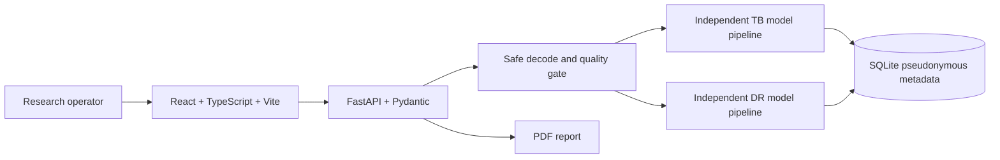

# Low-Cost Early Disease Screening from Medical Images

A local-first research and education prototype with two independent medical-imaging workflows: chest X-rays for TB-oriented screening support and retinal fundus photographs for diabetic-retinopathy grading support. This software is **not a medical device, does not diagnose, and is not a substitute for a qualified clinician**. A negative or low score is not reassurance and must not delay professional care.

## Current status

- FastAPI REST backend, React/TypeScript/Vite dashboard, SQLite metadata records, PDF reports, separate model pipelines, training/evaluation scaffolding, Docker Compose, and unit/API tests are included.
- No dataset, trained checkpoint, or measured evaluation result is included. Both models report `not-configured`; requests abstain instead of returning predictions.
- Uploaded files are decoded in memory. Medical image bytes are not persisted; only pseudonymous metadata is stored locally.
- This prototype has no authentication or public deployment hardening. Compose binds the app to local loopback. Do not expose it publicly.
- Quality checks are technical heuristics; they are not validated modality classifiers or clinical image quality tools. DICOM is out of scope.

## Features

- Explicit TB or DR task choice. No automatic modality/disease routing.
- Drag-and-drop image upload, local preview, byte and dimension limits, safe decoding, basic blur/contrast/exposure heuristics, and actionable API errors.
- Separate DenseNet121 TB binary and ResNet18 DR five-class PyTorch baselines. Weights must be trained and explicitly configured; automatic pretrained downloads are disabled.
- Abstention for poor quality, uncertain output and missing/unloadable models. Scores are never labelled clinical probabilities.
- Explainability interface reports when a tested overlay is unavailable. A saliency map is not a lesion localization map or medical proof.
- Pseudonymous case history, review annotations, deletion, operational metrics and PDF report export.
- Responsive dashboard, research/model status and settings views. The UI does not invent evaluation metrics.

## Architecture



The two tasks keep distinct label schemas and model/checkpoint settings. See [architecture](docs/architecture.md), [API reference](docs/api.md), [privacy threat model](docs/threat_model.md), [validation plan](docs/validation_plan.md), and the [dataset](docs/dataset_cards/README.md), [TB model](docs/model_cards/tb.md), and [DR model](docs/model_cards/dr.md) cards.

## Repository structure

```text
backend/app/             FastAPI routes, schemas, ORM, validation and pipelines
backend/tests/           API workflow and safety tests
frontend/src/            React views, API client, styles and UI tests
training/                Separate TB/DR configs, training and evaluation scripts
docs/                    Architecture, API, model/dataset cards and governance
docker-compose.yml       Local frontend/API containers and persistent metadata volume
```

## Run locally

### Docker Compose

1. Copy `.env.example` to `.env` and review local settings.
2. Install Docker Desktop or Docker Engine with Compose.
3. Run `docker compose up --build`.
4. Open the dashboard at `http://localhost:8080`; backend health is at `http://localhost:8000/api/health`, OpenAPI docs at `http://localhost:8000/docs`.
5. Stop with `docker compose down`. Metadata remains in the `screening_data` volume; remove that local volume only when you intend to delete the saved case records.

Both ports are bound to `127.0.0.1`. Keep that restriction. Do not expose this service on a public network.

### Native development

Backend (Python 3.11 recommended):

```powershell
cd backend
python -m venv .venv
.\.venv\Scripts\Activate.ps1
pip install -r requirements.txt
Copy-Item ..\.env.example .env
uvicorn app.main:app --reload --port 8000
```

Frontend (Node 20+):

```powershell
cd frontend
npm install
npm run dev
```

Vite proxies are not required when the frontend is served through Compose. For native development, set `VITE_API_URL=http://localhost:8000` in `frontend/.env.local` and set backend `CORS_ORIGINS=http://localhost:5173` in the root `.env`.

## Model setup and datasets

Do not download data automatically. Verify dataset access, license, terms, label meanings, privacy and redistribution conditions first. Document each source using a dataset card. Use patient-level splits and preserve a locked test set.

Prepare a CSV manifest with columns `image_path,patient_id,label` (relative image paths resolve from the manifest directory). TB labels are dataset-defined binary `0/1`. DR labels are `0–4` only for datasets with a verified matching severity schema.

```powershell
python training/train.py --task tb --manifest C:\data\tb\train.csv --dataset-id tb-dataset-version --dataset-card docs\dataset_cards\your-dataset.md --output backend\models\tb\model.pt --epochs 5 --device cpu --init-checkpoint C:\weights\densenet121-backbone.pt
python training/calibrate.py --task tb --manifest C:\data\tb\validation.csv --checkpoint backend\models\tb\model.pt --confirm-patient-disjoint
python training/evaluate.py --task tb --manifest C:\data\tb\locked-test.csv --checkpoint backend\models\tb\model.pt --device cpu
python training/train.py --task dr --manifest C:\data\dr\train.csv --dataset-id aptos-version --dataset-card docs\dataset_cards\your-dataset.md --output backend\models\dr\model.pt --epochs 5 --device cpu --init-checkpoint C:\weights\resnet18-backbone.pt
python training/calibrate.py --task dr --manifest C:\data\dr\validation.csv --checkpoint backend\models\dr\model.pt --confirm-patient-disjoint --minimum-accuracy 0.80
python training/evaluate.py --task dr --manifest C:\data\dr\locked-test.csv --checkpoint backend\models\dr\model.pt --device cpu
```

Set `TB_CHECKPOINT` and `DR_CHECKPOINT` to those checkpoint paths in the backend environment. Training output is an experimental baseline, not evidence of clinical validity. Have an independent, locked, patient-disjoint evaluation before registering results. Record configuration, checkpoint hashes, thresholds, confidence intervals, calibration, class-wise metrics, subgroups where justified and external generalization. No current weights/data/results are present in this repo.

## API overview

| Method | Endpoint | Function |
|---|---|---|
| GET | `/api/health` | Health and model readiness |
| GET | `/api/models` | Per-task configuration status |
| POST | `/api/screen/tb` | Multipart `file` chest X-ray flow |
| POST | `/api/screen/dr` | Multipart `file` fundus flow |
| GET | `/api/cases` | Paginated pseudonymous cases |
| GET | `/api/cases/{case_id}` | Case detail and review state |
| DELETE | `/api/cases/{case_id}` | Delete local case metadata |
| POST | `/api/review/{case_id}` | Mark reviewed, indeterminate or override |
| GET | `/api/metrics/summary` | Operational counts and stored offline evaluation records |
| POST | `/api/export/report` | PDF report for `{"case_id":"..."}` |

## Tests and build

```powershell
cd backend
pytest
cd ..\frontend
npm test
npm run build
```

Synthetic image fixtures in tests are software fixtures only, not patient data or model evidence. See test outputs from the current environment before claiming the suite passed.

## Privacy, security and limitations

- API upload limits default to 12 MB and 20 million pixels. Allowed raster formats are JPEG, PNG, WebP and BMP.
- The app does not store source image bytes. SQLite holds random case IDs, task, quality summary, output/abstention, provenance, review and audit metadata.
- Review notes should never contain patient identifiers. Logs avoid upload names and image bytes.
- Local prototype only; no user authentication/RBAC. Before hosting: perform a threat model and governance review, add access control, secure transport, rate limiting, appropriate encryption/retention, dependency scanning, monitoring and an incident process.
- Heuristic quality checks may fail to reject the wrong modality and do not certify diagnostic image quality. Human review is mandatory.
- No performance, latency, subgroup fairness, calibration or clinical effectiveness claims have been measured.

## Troubleshooting

- **Model not configured:** expected until a task-specific checkpoint and verified dataset/model card are configured.
- **Unsupported image:** use a decodable JPEG/PNG/WebP/BMP under configured byte and pixel limits. DICOM is not supported.
- **CORS error in native dev:** configure the exact frontend origin in `CORS_ORIGINS` and restart the API.
- **Container health check fails:** inspect `docker compose logs backend frontend`; confirm dependencies installed and ports 8080/8000 are free.
- **Training runs out of memory:** reduce `--batch-size` or image manifest size; CPU operation is supported but speed has not been measured.

## Safety statement

This project is for research and education only. It is not a medical device, is not clinically validated, and cannot diagnose, prescribe, rule out disease or replace a qualified clinician. A low score or negative output must not provide reassurance or delay professional evaluation.
