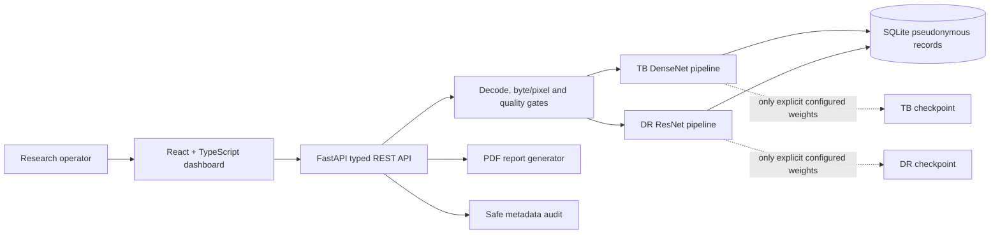

# Architecture and data flow

User-selected modality determines the pipeline. Images are decoded in memory and discarded after the request. Only pseudonymous case metadata is persisted. No image bytes or patient identifiers are logged. The two model heads, preprocessing entry points, label schemas, dataset documentation and evaluation results are separate.
